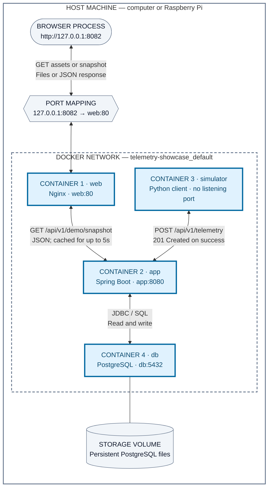

# ⚡ Telemetry Hub

**Industrial IoT telemetry ingestion & analytics service** built with Spring Boot.

Receives readings from power-grid sensors (voltage, current, frequency, temperature, vibration), validates them, detects anomalies in real time and exposes aggregated analytics over a REST API. Ships with a Python sensor simulator that generates realistic telemetry — including random fault injection — so the whole pipeline can be demoed locally.


## Interactive showcase

The English/German showcase in `showcase/` makes the complete sensor-to-database
path visible: a live chart, effective thresholds, four classification states,
recent readings, and PostgreSQL aggregates. A separate browser-only sandbox lets
visitors explore faults, threshold boundaries, and rejected input without changing
the shared live stream. Measurements are synthetic; live processing and storage
use the real service.

For a local visual preview, run `python3 -m http.server 8092 --bind 127.0.0.1 --directory showcase`
and open `http://127.0.0.1:8092/?preview=1`. Preview data is explicitly labelled;
the ordinary page never replaces an unavailable backend with generated readings.

The dedicated Raspberry Pi deployment uses `compose.showcase.yml`: Nginx serves
the page and a bounded read-only snapshot; the Python simulator writes through
the private container network. The `demo` Spring profile adds the snapshot and
seven-day retention for the configured demo sensor. Existing APIs remain unchanged.

See [showcase behavior and tests](docs/showcase.md) and
[Raspberry Pi / Cloudflare deployment](docs/showcase-deployment.md).

The [architecture guide (RU)](docs/architecture.md) explains the data flow,
application layers and deployment boundaries. The reusable
[visual design guide (RU)](DESIGN_SYSTEM.md) defines the palette, typography and
component principles for this and future project sites.
The intended public address is `https://telemetry.adskiyponchik.dev`; follow the
deployment checks before treating it as live.

## ✨ Features

- 📥 **Telemetry ingestion** — validated `POST` endpoint (Jakarta Bean Validation) for sensor readings
- 🚨 **Anomaly detection** — every reading is classified as `OK`, `ALARM`, `MECHANICAL_DAMAGE` or both, based on configurable voltage/frequency corridors and per-sensor temperature/vibration thresholds
- 📊 **Analytics API** — per-sensor aggregates over a sliding time window (reading count, alarm count, average voltage & frequency)
- ⚙️ **Externalized configuration** — all limits (`198–242 V`, `49–51 Hz`, max temperature/vibration, analytics window) live in `application.yaml` via `@ConfigurationProperties`
- 🧩 **Per-sensor thresholds** — override defaults for individual sensors, stored in the database
- 🩺 **Observability** — Spring Boot Actuator (`health`, `info`, `metrics`)
- 🛰️ **Sensor simulator** — `simulator.py` streams sinusoidal voltage with noise and ~2% random fault spikes
- 🧪 **Tests** — service-layer unit tests + Spring Boot integration tests
- 🌗 **Profiles** — separate `dev` / `prod` configurations

## 🏗️ Architecture

```
simulator.py ──POST──▶ TelemetryController ──▶ TelemetryService ──▶ PostgreSQL
                                                    │  (validation + status
                                                    │   classification)
                       AnalyticsController ◀──── AnalyticsService
                        GET /analytics/{id}        (windowed aggregation)
```

Classic layered design: `controller → service → repository`, DTOs decoupled from JPA entities, centralized error handling via `@RestControllerAdvice` (`GlobalExceptionHandler`).

### Showcase containers and addresses

This diagram describes **[compose.showcase.yml](compose.showcase.yml)** with default
ports. It runs four containers on one Compose network. The browser runs outside
that network; only Nginx has a published host port.



**Legend:** only the four blue rectangles labelled **CONTAINER 1–4** are
containers. They are peers; none contains another. The solid outer frame is the
host machine; the dashed frame is their shared network. The grey rounded box,
hexagon and cylinder represent the browser, port mapping and storage, respectively.
Container numbers identify the boxes; they do not indicate startup order.

The browser downloads JavaScript from Nginx and **executes it in the browser**.
`refresh()` requests `/api/v1/demo/snapshot` from the same origin as the page.
Nginx forwards that request to Java or returns a cached response. The simulator
writes directly to Java inside the network; browser sandbox buttons never POST
to the backend.

| Caller | Address it uses | Destination / result |
| --- | --- | --- |
| Browser on the host | `http://127.0.0.1:8082/` | Nginx returns the page and its static assets |
| Browser JavaScript | `/api/v1/demo/snapshot` | Same host and port as the page; Nginx returns snapshot JSON |
| Nginx container | `http://app:8080/api/v1/demo/snapshot` | Java's `DemoController` → `DemoSnapshotService` |
| Simulator container | `http://app:8080/api/v1/telemetry` | Java's ingestion endpoint |
| Java container | `jdbc:postgresql://db:5432/telemetry_showcase` | PostgreSQL; database name can be overridden |

**How to read the addresses:**

- `web`, `app` and `db` are Compose service names resolved by Docker's internal
  DNS. They are not public domain names, and container IP addresses need not be
  hardcoded. The network name above assumes the default project name.
- `localhost` / `127.0.0.1` refers to the machine or container making the request.
  Inside `web`, `localhost:8080` would refer to `web` itself, so Nginx uses
  `app:8080` to reach Java. A host browser uses the published port instead.
- `127.0.0.1:8082:80` means **host address : host port : container port**.
  `TELEMETRY_HTTP_PORT` can change `8082`; Nginx still listens on port `80` inside
  its container. Binding to loopback does not expose this port directly to the LAN.
- Java and PostgreSQL have no published host ports in this Compose file.
  `expose: 8080` documents Java's internal port; it does not publish it to the host
  or act as an access-control rule between containers.

See Docker's [Compose networking guide](https://docs.docker.com/compose/how-tos/networking/)
for service-name discovery and the distinction between host and container ports.

Nginx's configuration lives in [deployment/nginx.conf](deployment/nginx.conf).
The [web Dockerfile](showcase/Dockerfile) copies it to
`/etc/nginx/conf.d/default.conf` and places the site files in
`/usr/share/nginx/html/` inside the image.

| Request through the showcase Nginx | Behavior |
| --- | --- |
| `GET /` or an existing static asset | Serve the site file |
| `GET /api/v1/demo/snapshot` | Proxy to Java or serve a fresh cached response |
| Snapshot URL with a nonempty query string | `400 Bad Request` |
| `POST /api/v1/demo/snapshot` | `403 Forbidden` |
| Other `/api` paths, `/actuator`, `/swagger-ui`, `/v3/api-docs` | `404 Not Found`; not forwarded to Java |

`HEAD` is also allowed for the snapshot. These restrictions apply at the Nginx
entry point; the simulator can still reach Java's POST endpoint internally.
An optional Cloudflare Tunnel can connect public HTTPS traffic to the host's
loopback entry point. It is not one of these four Compose services; this diagram
does not assert that a public tunnel is running. See the
[deployment guide](docs/showcase-deployment.md) for tunnel placement options.

### Keep development and showcase addresses separate

The root [docker-compose.yml](docker-compose.yml) is a **different environment**:

| Launch mode | Browser / host addresses | Java → PostgreSQL |
| --- | --- | --- |
| Showcase: `compose.showcase.yml` | Nginx at `127.0.0.1:8082`; no published Java or DB port | `db:5432` |
| Development: `docker-compose.yml`, all services | Java at `localhost:8080`, PostgreSQL at `localhost:5433`, Grafana at `localhost:3000` | `db:5432` |
| Development: only `db` in Docker, Java via Maven on the host | Java at `localhost:8080`, PostgreSQL at `localhost:5433` | `localhost:5433` |

The development Compose has no Nginx or simulator container. Grafana is present
there, but this repository does not provision its PostgreSQL data source or
dashboards. Its presence does not mean it powers the showcase chart: that chart
is SVG rendered by the browser's JavaScript.

## 🔌 API

| Method | Endpoint                        | Description                                        |
|--------|---------------------------------|----------------------------------------------------|
| `POST` | `/api/v1/telemetry`             | Ingest a sensor reading → `201 Created`            |
| `GET`  | `/api/v1/telemetry`             | Paginated list of stored telemetry (`Pageable`)    |
| `GET`  | `/api/v1/analytics/{sensorId}`  | Aggregated stats for a sensor (24h window default) |

**Example request:**

```bash
curl -X POST http://localhost:8080/api/v1/telemetry \
  -H "Content-Type: application/json" \
  -d '{
    "sensorId": "MGD-PWR-01",
    "location": "Magdeburg-Nord",
    "voltage": 231.4,
    "current": 5.1,
    "frequency": 50.02,
    "temperature": 36.5,
    "vibration": 3.2
  }'
```

**Example analytics response:**

```json
{
  "sensorId": "MGD-PWR-01",
  "totalReadings": 1440,
  "alarmCount": 27,
  "avgVoltage": 230.12,
  "avgFrequency": 49.98
}
```

## 🚀 Getting started

**Prerequisites:** JDK 21, PostgreSQL, Python 3 (for the simulator).

```bash
# 1. Start the service (dev profile is active by default)
./mvnw spring-boot:run

# 2. Feed it with simulated sensor data
pip install requests
python simulator.py
```

Run tests (requires a running Docker daemon accessible to your user;
Testcontainers creates a temporary PostgreSQL instance):

```bash
./mvnw test
```

## Continuous integration

GitHub Actions runs on pushes to `main`, pull requests targeting `main`, and manual
runs from the **Actions → CI → Run workflow** page once the workflow is on the default branch.

- **Build and test** uses Temurin JDK 21 and the Maven Wrapper to run
  `./mvnw --batch-mode --no-transfer-progress clean verify`. This includes unit,
  MVC, and PostgreSQL integration tests, Flyway migrations, JAR packaging, and JaCoCo coverage.
- The build job also runs the JavaScript classification fixtures and Python simulator tests.
- Testcontainers manages PostgreSQL on the runner. No `.env`, repository secrets,
  external database, or `docker compose up` is required.
- **Build Docker image** checks the multi-stage Java Dockerfile and the showcase /
  simulator images after tests pass. Images are not pushed to a registry or deployed.
- Each run saves available test/coverage reports for 14 days, including test reports
  after failures, and the application JAR for 7 days after a successful build.
  Coverage is generated during `verify`, so it may be absent when tests fail.
- Older runs for the same branch or pull request are cancelled. Jobs have a
  15-minute timeout and the workflow token has read-only repository access.

Mockito is loaded explicitly as a test JVM agent on Java 21, alongside JaCoCo.
No extra `JAVA_TOOL_OPTIONS` are needed. To reproduce both checks locally:

```bash
./mvnw --batch-mode --no-transfer-progress clean verify
docker build --tag telemetry-service:ci .
```

After the first successful GitHub run, configure a repository ruleset or branch
protection for `main` requiring **Build and test** and **Build Docker image** before
merging. This is a repository setting, not something the workflow enables itself.

Dependabot checks GitHub Actions, Maven dependencies, and Docker base images weekly.
Action revisions are pinned to commit hashes; review and merge update pull requests
to keep them current.

## ⚙️ Configuration

Key settings in `src/main/resources/application.yaml`:

```yaml
telemetry:
  voltage:    { min: 198.0, max: 242.0 }   # nominal grid corridor
  frequency:  { min: 49.0,  max: 51.0 }
  thresholds:
    default-max-temperature: 80.0
    default-max-vibration: 10.0
  analytics:
    window-hours: 24
```

## 🛠️ Tech stack

Java 21 · Spring Boot 4 (Web MVC, Data JPA, Validation, Actuator) · PostgreSQL · Lombok · Maven · Python (simulator)

## 📄 License

See [LICENCE](LICENCE).
