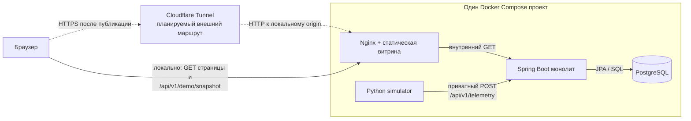

# Архитектура Telemetry Hub

## Что это за система

Telemetry Hub — один Spring Boot монолит, который принимает показания датчиков,
проверяет формат, вычисляет доменный статус, сохраняет результат в PostgreSQL и
строит агрегаты. Витрина добавляет к нему Python-симулятор и статический сайт.
Четыре контейнера в `compose.showcase.yml` выполняют разные роли, но не являются
четырьмя микросервисами: бизнес-логика и API остаются в одном Java-процессе.

Cloudflare на схеме показывает предусмотренный маршрут размещения. Наличие
конфигурации и инструкции в репозитории не подтверждает, что tunnel или публичный
субдомен сейчас работают.

## Java-приложение: слои и ответственность

Поток внутри монолита следует цепочке `controller → service → repository`:

1. Контроллер переводит HTTP-запрос в DTO и выбирает HTTP-статус.
2. Сервис выполняет правила предметной области и задаёт границу транзакции.
3. Репозиторий через Spring Data JPA читает и изменяет PostgreSQL.
4. DTO остаются HTTP-контрактом, а JPA entities описывают хранение.

Точки входа находятся в
[`TelemetryController`](../src/main/java/de/iot/hub/telemetry/controller/TelemetryController.java),
[`AnalyticsController`](../src/main/java/de/iot/hub/telemetry/controller/AnalyticsController.java)
и включаемом только профилем `demo`
[`DemoController`](../src/main/java/de/iot/hub/telemetry/controller/DemoController.java).
Централизованный обработчик превращает ошибки в JSON: ошибки валидации и JSON дают
`400`, отсутствие аналитики — `404`, необработанная ошибка — `500`.

## Приём показания: проверка не равна классификации

`POST /api/v1/telemetry` проходит два разных этапа:

1. Jakarta Validation проверяет обязательные поля и допустимую форму данных:
   непустой `sensorId` до 255 символов, положительные voltage/current/frequency,
   любое числовое temperature и неотрицательную vibration. Ошибка останавливает
   запрос с `400`; запись в БД не создаётся.
2. [`TelemetryService`](../src/main/java/de/iot/hub/telemetry/service/TelemetryService.java)
   классифицирует уже валидное показание и сохраняет его в одной транзакции.

Электрическая аномалия означает выход voltage или frequency за глобальный диапазон.
Механическая — превышение максимума temperature или vibration. Комбинация двух
условий даёт `ALARM_AND_MECHANICAL_DAMAGE`. Равенство порогу считается нормой,
а current сохраняется, но в классификации не участвует.

Для temperature и vibration сначала ищется запись датчика в `sensor_configs`;
если её нет, используются значения по умолчанию из `application.yaml`.
Voltage и frequency всегда используют глобальные настройки. Успешный `201 Created`
означает «валидно и сохранено», а не «статус OK». Повторный POST создаёт ещё одну
строку: ключа события, дедупликации и безопасного автоматического повтора пока нет.

## Два независимых потока витрины

Симулятор работает внутри сети Compose и раз в пять секунд отправляет POST прямо
на `app:8080`. Он последовательно показывает normal, electrical, mechanical,
combined и recovery. При сетевой ошибке наблюдение не повторяется, потому что
текущий POST не идемпотентен; цикл переходит к следующему показанию.

Браузер не отправляет телеметрию. Он получает HTML/CSS/JavaScript и делает
same-origin GET на `/api/v1/demo/snapshot`, то есть обращается к тому же origin,
с которого загружена страница. Nginx проксирует только этот путь к Java и извне
закрывает остальные `/api`, Actuator, Swagger и OpenAPI. Запросы с параметрами
отклоняются, а ответ snapshot кешируется Nginx на пять секунд.

Встроенная sandbox-песочница полностью локальна: JavaScript повторяет правила на
фиксированных демонстрационных порогах, показывает условные `400`/`201` и ничего
не пишет в PostgreSQL. Режим `?preview=1` также явно создаёт иллюстративный snapshot
в браузере. В обычном режиме ошибка API не заменяется выдуманными данными.

## Публичный snapshot

[`DemoSnapshotService`](../src/main/java/de/iot/hub/telemetry/service/DemoSnapshotService.java)
возвращает данные только одного настроенного demo-датчика:

- эффективные пороги и время формирования ответа;
- последнее сохранённое показание, даже если оно старше окна графика;
- максимум 180 точек за последние 15 минут в хронологическом порядке;
- агрегат за настроенное окно, сейчас 24 часа, либо `null` без данных.

Все чтения выполняются в read-only транзакции с `REPEATABLE_READ`. Это даёт одному
HTTP-ответу согласованный снимок БД: новые POST от симулятора не должны попасть
только в часть запросов внутри snapshot. В demo-окружении Clock, JVM и PostgreSQL
настроены на UTC, а endpoint явно сериализует `Z`/UTC. Это не конвертирует старые
данные других окружений, где entity всё ещё хранит `LocalDateTime` без зоны.

Браузер опрашивает snapshot каждые пять секунд только на видимой вкладке, проверяет
форму ответа и прерывает запрос через семь секунд. Nginx может вернуть общий
пятисекундный кеш нескольким посетителям. UI учитывает возраст кеша, помечает
показание старше 20 секунд как stale и при ошибке сохраняет последний snapshot в
памяти вкладки с предупреждением offline. После перезагрузки страницы этой памяти нет.

## Аналитика и хранение

Flyway-миграция [`V1__init_schema.sql`](../src/main/resources/db/migration/V1__init_schema.sql)
создаёт `telemetry_data`, `sensor_configs` и индекс `(sensor_id, timestamp)`.
Hibernate работает с `ddl-auto=validate`: он сверяет entity со схемой, но не должен
сам создавать production-таблицы. Новые изменения схемы требуют новой миграции.

JPQL-запрос считает строки, средние voltage/frequency и `alarmCount` прямо в БД.
`alarmCount` включает `ALARM` и `ALARM_AND_MECHANICAL_DAMAGE`, но не отдельный
`MECHANICAL_DAMAGE`. Поэтому это счётчик электрических тревог, а не всех ненормальных
статусов. Обычный `/api/v1/analytics/{sensorId}` отвечает `404`, если в окне нет
данных; demo snapshot в той же ситуации возвращает `analytics: null`.

Раз в час [`DemoRetentionService`](../src/main/java/de/iot/hub/telemetry/service/DemoRetentionService.java)
удаляет только строки настроенного demo-датчика старше срока хранения, по умолчанию
семи дней. Другие sensorId эта задача не затрагивает. Ограничение 180 точек относится
только к ответу snapshot и не является политикой хранения.

## Запуск и граница доступа

Compose ждёт healthcheck PostgreSQL перед стартом Java, а симулятор — healthcheck
Java. При старте приложения Flyway применяет миграции, затем Hibernate проверяет
схему; готовое приложение начинает принимать данные. Nginx стартует независимо,
поэтому статическая страница и локальная sandbox могут открыться раньше backend.

Наружу Compose публикует только Nginx на `127.0.0.1:8082`; Java и PostgreSQL имеют
лишь внутренние адреса сети Compose. Предполагаемый Cloudflare Tunnel должен вести
к этому loopback-адресу с хоста либо к отдельному alias Nginx из контейнера tunnel.
Маршрутизатору не требуется открывать порт.

Это ограничение периметра, а не пользовательская авторизация. В приложении пока
нет Spring Security, учётных записей и прав на sensorId. Любой клиент, получивший доступ к внутреннему
API, сможет отправлять POST и читать обычные endpoints. Секрет БД задаётся окружением;
значения из example-файлов не подходят как production-секреты.

## Как проверяется архитектура

- Java unit/controller tests проверяют правила, HTTP-контракты, UTC и отсутствие
  demo-controller без профиля `demo`.
- Repository и сквозные Spring tests используют временный PostgreSQL через
  Testcontainers и проверяют реальные JPA/SQL-механизмы.
- Одна JSON-fixture прогоняется Java- и JavaScript-тестами, чтобы правила sandbox
  не расходились с backend на известных примерах.
- Python tests проверяют цикл, конфигурацию и отсутствие повторов POST; HTTP smoke
  test проверяет публичные разрешённые и закрытые маршруты.
- CI запускает Maven `clean verify`, JavaScript-тесты в Node.js и Python-тесты, затем собирает
  Java, web и simulator images. Сам workflow не доказывает успешный свежий прогон,
  включённую защиту ветки или действующее публичное размещение.

Фактические ограничения контракта: vibration пока обозначена условной единицей
`a.u.`; `LocalDateTime` старых API не содержит зону; а Nginx-защита действует только
на публичном web-входе, не внутри Compose-сети.
