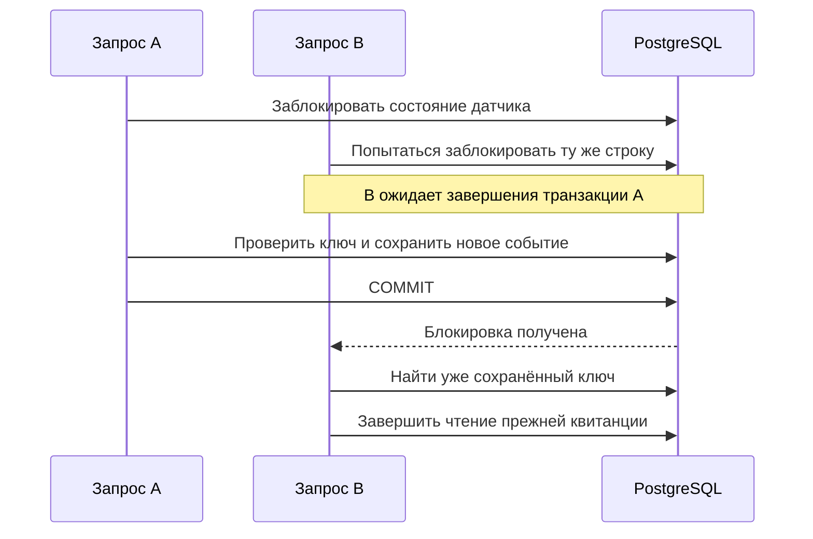

# Разбор первого релиза: изменения и причины решений

Этот документ объясняет текущую реализацию надёжного приёма показаний и
температурных инцидентов. Точный HTTP-контракт и команды проверки находятся в
[temperature-incidents.md](temperature-incidents.md), результаты выполненных
проверок — в [release-validation.md](release-validation.md).

## 1. Какие сущности теперь различаются

В системе есть три разных понятия:

| Понятие | Что означает | Где хранится |
| --- | --- | --- |
| Показание | Один замер с конкретными входными значениями | `telemetry_data` |
| Состояние датчика | Текущие последовательности превышений и нормальных значений | `temperature_alert_states` |
| Инцидент | Открытая или восстановленная температурная проблема, её подтверждение и данные открытия | `temperature_incidents` |

HTTP-запрос — попытка доставить показание. Одно показание может потребовать
нескольких запросов, но должно влиять на состояние один раз, пока сохраняется его
запись. Инцидент может объединять много показаний и сохраняется после восстановления.

Раньше повторный POST создавал строку и снова двигал счётчик. Кроме того, счётчик
терял признак тревоги после первого нормального значения. Теперь доставка,
классификация отдельного показания и жизненный цикл инцидента имеют свои правила.

## 2. Почему идентификатор создаёт отправитель

В `TelemetryRequest` добавлен обязательный UUID `eventId`. Ключ события —
`(sensorId, eventId)`. Внутренний `id` строки по-прежнему генерирует PostgreSQL.

Причина создания UUID до первого запроса — неоднозначность сетевого таймаута:
сервер мог сохранить показание, а ответ мог потеряться. Клиент повторяет тот же
ключ и получает прежний результат. Если создавать UUID заново для каждой попытки,
сервер будет видеть разные события. Если единственный идентификатор выдаёт сервер
в потерянном ответе, клиент не сможет использовать его для безопасного повтора.

Сервис ищет запись по ключу и сравнивает входные значения: location и все пять
метрик. Сравнение выполняется после разбора JSON; порядок полей и запись числа
как `230` или `230.0` не создают конфликт. Для `Double` используется точное
`Objects.equals`, без допуска измерительной погрешности. Для ключа события
изменённое значение должно считаться ошибкой повторной доставки.

Сравниваются сами сохранённые поля: дополнительная сериализация JSON и хранение
хеша содержимого здесь не нужны. Важно не включать в сравнение текущие пороги:
это настройки сервера, а не содержимое исходного события.

| Ситуация | Ответ | Последствия |
| --- | --- | --- |
| Новый ключ, валидные данные | `201` и квитанция | Запись и обработка нового показания |
| Существующий ключ, те же значения | `200` и прежняя квитанция | Показание и счётчики не меняются |
| Существующий ключ, другое содержимое | `409` | Конфликт не изменяет данные |
| Некорректный запрос | `400` | Сервис обработки не вызывается |

Квитанция содержит `id`, `eventId`, `sensorId`, `status`, `timestamp`. Она описывает
исходное принятие показания. Повтор после изменения порогов возвращает сохранённый
статус и не запускает повторную классификацию.

`TelemetryIngestionResult` передаёт контроллеру квитанцию и признак создания.
Выбор `201` или `200` остаётся в контроллере; сервис не выбирает HTTP-статус.

## 3. Почему проверки существования недостаточно и нужна блокировка

Без синхронизации два запроса могут одновременно проверить отсутствие ключа и
оба перейти к записи. Для температурного состояния похожая проблема возникает,
если два потока прочитали один счётчик и независимо рассчитали следующее значение.

В проекте уже существовали создание строки состояния через
`ON CONFLICT DO NOTHING` и её `PESSIMISTIC_WRITE`-блокировка. Теперь эта граница
перенесена в начало обработки: она покрывает дедупликацию, чтение порогов и
изменение показаний/инцидентов. Разные датчики используют разные строки состояния.

Дополнительно V3 создаёт уникальность `(sensor_id, event_id)` в PostgreSQL.
Блокировка обеспечивает правильную последовательность бизнес-обработки, а
ограничение БД защищает инвариант хранения и от других путей записи.

Компромисс: события одного датчика обрабатываются последовательно. Долгая
транзакция задержит следующие события того же датчика. Это осознанная простая
модель для текущего сервиса; её пропускную способность отдельно не измеряли.
Порядок означает порядок захвата блокировки, а не время измерения на устройстве.

Реализация: [TelemetryService](../src/main/java/de/iot/hub/telemetry/service/TelemetryService.java)
и [TemperatureAlertStateRepository](../src/main/java/de/iot/hub/telemetry/repository/TemperatureAlertStateRepository.java).

## 4. Что даёт транзакция и как здесь работает JPA

Для нового события в одной транзакции выполняется последовательность:

1. Создать при необходимости и заблокировать состояние датчика.
2. Проверить ключ; повтор вернуть до чтения действующих порогов.
3. Для нового события получить пороги и классифицировать показание.
4. Рассчитать и применить переход температурного состояния.
5. Создать инцидент или установить его восстановление, если переход это требует.
6. Сохранить показание и вернуть квитанцию.

Ошибка сохранения откатывает изменения показания, счётчиков и инцидента вместе.
Атомарность даёт транзакция; защиту от конкурентного пересчёта счётчика даёт
блокировка. Это разные механизмы.

Загруженное состояние датчика является managed entity внутри persistence context.
JPA отслеживает изменения его полей и записывает их при flush. Поэтому после
`setConsecutiveBreaches` отдельный `save(state)` не обязателен. Аналогично
сохраняются подтверждение и восстановление уже загруженного инцидента.
Новый инцидент, напротив, явно передаётся в `save`.

Показание сохраняется через `saveAndFlush`: изменения отправляются в БД до
формирования результата метода, выявляются ошибки ограничений, доступен ID строки.
Flush ещё не означает commit — транзакция всё ещё может откатиться. Контроллер
получает результат вызова сервиса после завершения его транзакционной границы.

## 5. Почему инцидент — отдельная запись

Счётчик отвечает на вопрос о текущей серии. Он не хранит, когда открывалась
проблема, какие значения её вызвали и была ли она замечена человеком.

Новая сущность `TemperatureIncident` сохраняет времена открытия, подтверждения и
восстановления, температуру и порог при открытии, а также признак переноса старого
состояния. Порог открытия фиксируется, чтобы последующее изменение настройки не
переписало объяснение уже случившегося инцидента.

Для нового инцидента `openedAt` — время открытия после третьего превышения.
Это не восстановленное время физического начала перегрева. Значение
`temperatureAtOpen` также относится к третьему, открывшему инцидент показанию.

Частичный уникальный индекс разрешает только один инцидент с `recovered_at IS NULL`
на датчик. После восстановления старый инцидент остаётся историей, а следующая
серия может создать новый.

## 6. Открытие, восстановление и подтверждение

`TemperatureAlertEvaluator.evaluateLifecycle` — чистая функция. Она получает
температуру, порог, два счётчика и признак активного инцидента; возвращает новые
счётчики и признаки необходимости открыть/восстановить инцидент. Она не читает
БД, не выбирает HTTP-ответы и не получает системное время.

Так правило можно проверять последовательностями значений без Spring и Docker.
Сервис отвечает за хранение вычисленного перехода.

При пороге 80 °C и нормальных остальных метриках:

| Действие | Серия превышений | Серия восстановления | Инцидент |
| --- | ---: | ---: | --- |
| E1: 81 °C | 1 | 0 | Нет |
| Повтор E1 | 1 | 0 | Нет |
| E2: 82 °C | 2 | 0 | Нет |
| E3: 83 °C | 3 | 0 | Открыт |
| Подтверждение через PUT | 3 | 0 | Активен, подтверждён |
| E4: 80 °C | 0 | 1 | Активен, подтверждён |
| E5: 79 °C | 0 | 2 | Активен, подтверждён |
| E6: 80 °C | 0 | 0 | Восстановлен, подтверждение сохранено |

E1–E6 здесь — условные обозначения разных UUID. Новый перегрев между нормальными
значениями обнуляет серию восстановления, сохраняя тот же активный инцидент.
После восстановления оба счётчика обнуляются.

Три последовательных сообщения — правило этого релиза. Оно уменьшает реакцию на
единичный выброс, но не задаёт длительность перегрева в секундах и не является
подтверждённым физическим критерием неисправности оборудования.

Последнее показание может иметь статус `OK`, пока инцидент ещё восстанавливается.
Поэтому `alertActive` теперь определяется наличием невосстановленного инцидента,
а не выражением `consecutiveBreaches >= 3`.

Подтверждение означает, что на проблему обратили внимание; восстановление — что
получена необходимая серия нормальных значений. Это независимые факты. Поэтому
хранятся отдельные `acknowledgedAt` и `recoveredAt`, а не одна линейная цепочка
статусов. Разрешено подтвердить уже восстановленный инцидент.

PUT подтверждения повторяем: первое время сохраняется, последующие вызовы его не
меняют. Личность оператора и журнал всех его действий в этом релизе отсутствуют.

## 7. Почему подтверждение тоже блокирует инцидент

Подтверждение может совпасть с обработкой третьего нормального показания.
Без общей синхронизации два объекта JPA, загруженные разными транзакциями,
могли бы сохранить устаревшие поля и потерять одну из отметок.

Обе операции блокируют строку инцидента перед изменением. При приёме порядок
блокировок — `state → incident`. Подтверждение берёт только блокировку incident и
не пытается после неё заблокировать state. Обратного порядка между этими двумя
операциями нет. Конкурентный сценарий проверен отдельным интеграционным тестом.

Реализация: [TemperatureIncidentService](../src/main/java/de/iot/hub/telemetry/service/TemperatureIncidentService.java)
и [TemperatureIncidentRepository](../src/main/java/de/iot/hub/telemetry/repository/TemperatureIncidentRepository.java).

## 8. Время, точность и перенос старых данных

Общий внедряемый `Clock` даёт управляемое время: тест может передать фиксированные
часы. Его системная зона сохраняет прежнюю семантику `LocalDateTime` у показаний.
Новые времена инцидентов представлены `Instant` и сериализуются в UTC.
Автоматического перевода старых локальных времён в UTC нет: для этого потребовалось
бы знать происхождение существующих значений.

Перед сохранением новые времена обрезаются до микросекунд. Это соответствует
точности колонок `TIMESTAMP(6)`: первая квитанция и квитанция после чтения БД должны
совпадать по времени, несмотря на более высокую точность Java-часов.

V1 и V2 сохраняются. V3 добавляет nullable `event_id` и уникальность ключа.
У старых строк идентификатор остаётся неизвестным, новые HTTP-запросы обязаны его
передавать. Это сохраняет данные, но меняет требования к старым клиентам.

V4 добавляет восстановление и таблицу инцидентов. Старые счётчики остаются;
состояния с числом превышений >=3 становятся активными перенесёнными инцидентами.
Из старого счётчика невозможно доказать точное время открытия, исходные значения
или уникальность прежних событий. Поэтому `migrated=true`, а неизвестные поля —
`NULL`. Витрина показывает их как неизвестные, включая порог, а не как ноль.

## 9. Как изменилась витрина и очистка

В существующий demo snapshot добавлены состояние тревоги, активный инцидент и до
пяти восстановленных инцидентов настроенного датчика. Один read-only запрос под
`REPEATABLE_READ` читает согласованный снимок: параллельная запись не должна
попасть лишь в часть SQL-запросов, составляющих этот ответ. Это свойство одного
snapshot, а не общей атомарности нескольких отдельных HTTP-вызовов.

Публичный Nginx по-прежнему пропускает только ограниченный snapshot. Браузер
показывает историю и прогресс, а подтверждение выполняется через внутренний API.
EN/DE, маркировка иллюстративного preview, сохранение последнего снимка при ошибке
и браузерная песочница поддерживаются. Песочница показывает локальную
классификацию и не симулирует полноценный серверный жизненный цикл.

История внутреннего API сортируется по ID по убыванию; размер страницы ограничен
100, датчик обязателен. Это ограничивает объём одного ответа и не требует
сортировки по неизвестному времени открытия старых инцидентов.

Очистка demo работает под блокировкой состояния его датчика. Удаляются старые
показания и инциденты, восстановленные раньше срока хранения. Активные инциденты
сохраняются независимо от давности открытия; другие датчики не затрагиваются.

Защита от дублей использует саму строку показания, поэтому заканчивается после её
удаления. Этот выбранный компромисс позволяет обойтись без отдельного журнала
ключей с собственной политикой хранения. По умолчанию срок demo — семь дней.

## 10. Почему симулятор теперь повторяет отправку

Раньше симулятор сознательно не повторял POST: повтор мог создать дубль.
Теперь генератор создаёт UUID один раз, а отправка повторяет тот же payload.

Всего допускаются три попытки при сетевой ошибке или `5xx`, с паузами 0,5 и
1 секунду. `200` и `201` означают успешную доставку; `4xx`, включая конфликт `409`,
не повторяются автоматически, поскольку неизменённый запрос не устраняет причину.

Ограничение числа попыток не позволяет одной проблемной отправке навсегда занять
цикл симулятора. Постоянной очереди нет: после исчерпания попыток клиент переходит
к следующему показанию. При таймауте доставка остаётся неопределённой — сервер
мог сохранить событие. Защита от дублей не равна гарантии доставки каждого замера.

## 11. Дополнительная защита числовых данных

При ревью и проверке реального HTTP обнаружилось, что исходная валидация позволяла
сохранить бесконечные значения и NaN в температуре. Сравнения с NaN не дают
обычного результата, а нечисловые данные могут испортить агрегаты; витрина такие
снимки отклоняет.

Добавлена небольшая Jakarta Validation-аннотация `@Finite` на все пять метрик.
`@NotNull` продолжает проверять наличие, `@Positive`/`@PositiveOrZero` — знак,
`@Finite` — конечность. Она возвращает true для null, оставляя отсутствие значения
ответственности `@NotNull`. Ошибка останавливает запрос до обращения к сервису.

OpenAPI дополнен явными ответами `201` и `200`: автоматическое описание не могло
вывести оба исхода из динамического `ResponseEntity.status(...)`. Отдельный тест
проверяет сгенерированную спецификацию и обязательность eventId.

## 12. Чем подтверждён результат и где границы

При реализации прошли 110 Java-тестов, включая настоящий временный PostgreSQL;
36 JavaScript-тестов в Node 22 и 12 Python-тестов. Проверялись не только обычные
ответы, но и 100 событий + 20 повторов, конкурентные запросы, конфликт содержимого,
гонка подтверждения с восстановлением, откат, обновление с V2 и очистка.

Также были собраны три образа, выполнен HTTP-сценарий, приложение перезапущено и
пересоздано на той же базе; квитанции и состояния сохранились. Витрина проверялась
на широком/узком экране и двух языках. Полные результаты и ограничения проверки
зафиксированы в [release-validation.md](release-validation.md).

В рамках этого описания тесты заново не запускались: сверены код и сохранённый
отчёт реализации. Код приложения при подготовке разбора не изменялся.

Границы решения: последовательность обработки вместо времени измерения;
ограниченный срок распознавания дублей; ограниченные повторы без постоянной
очереди; отсутствие аутентификации, личности оператора, контроля пропавшего сигнала
и уведомлений. Сохранение инцидентов даёт основу для этих следующих возможностей.
Удалённый CI, ARM64 runtime и публикация на Raspberry Pi этим релизным прогоном
не подтверждались.
